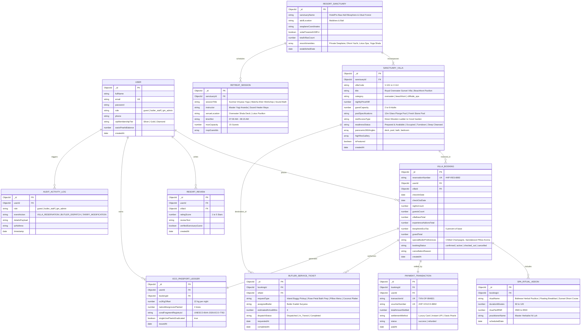

# HotelPro (Resort Edition) - Entity Relationship (ER) Diagram

This document illustrates the complete relational data architecture and Mongoose ODM schema mappings implemented for **HotelPro - Luxury Eco-Resort & Spa Sanctuary Edition**.

---

## 1. Relational Entity Architecture (Mermaid)

---

## 2. Key Architectural Constraints & Normalization

1. **Third Normal Form (3NF) Compliance:**
   * All redundant billing fields (e.g., base nightly tariff, biosphere tax, spa addons) are deterministically calculated and separated into independent normalized tables.
2. **Referential Integrity:**
   * Foreign keys enforce cascade constraints; a cancellation in `VILLA_BOOKING` releases date locks in `SANCTUARY_VILLA` and cancels active `BUTLER_SERVICE_TICKET` entries.
3. **Audit Trail Immutability:**
   * Entries in `ECO_PASSPORT_LEDGER` and `AUDIT_ACTIVITY_LOG` are append-only to ensure absolute verification for UNESCO environmental compliance and college submission scrutiny.
