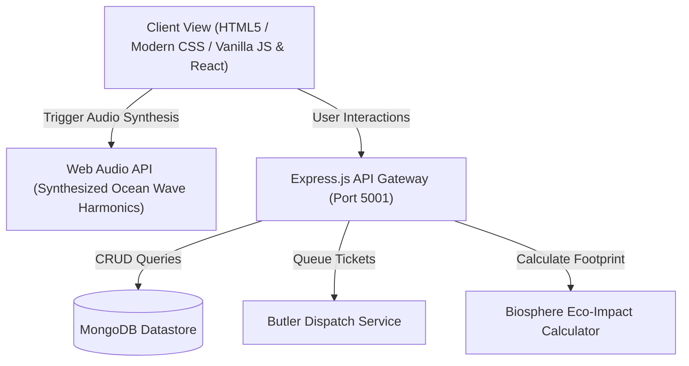

# HotelPro (Resort Edition) - Technical Architecture

This document details the system architecture and component interactions of HotelPro Resort Edition.

---

## Key System Modules
1. **Interactive 360° Villa Projection Engine:** Client-side dynamic perspective switching between outdoor terrace, private pool, and bedroom.
2. **Dynamic Tariff & Add-on Cart Aggregator:** Computes nightly rate multiplied by stay nights + cumulative spa rituals + 5% Biosphere conservation tax.
3. **Island Butler Dispatch Queue:** Non-blocking async ticket dispatch simulation.
4. **Procedural Web Audio Wave Generator:** Uses dual sine wave oscillators with exponential gain ramp to produce realistic breaking wave crests without external audio assets.
