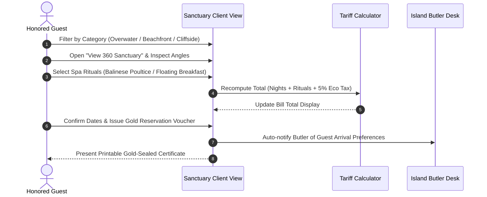
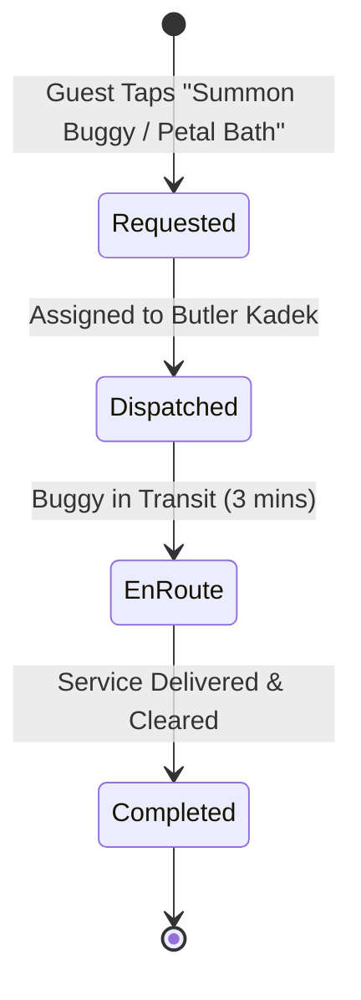

# HotelPro (Resort Edition) - User Flow Diagrams

This document illustrates the operational journeys for Guests, Butlers, and Managers.

---

## 1. Guest Villa Reservation & Spa Journey

---

## 2. Butler Request & Service Lifecycle

